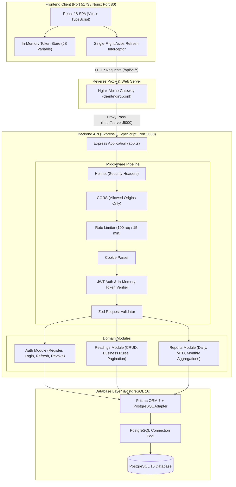
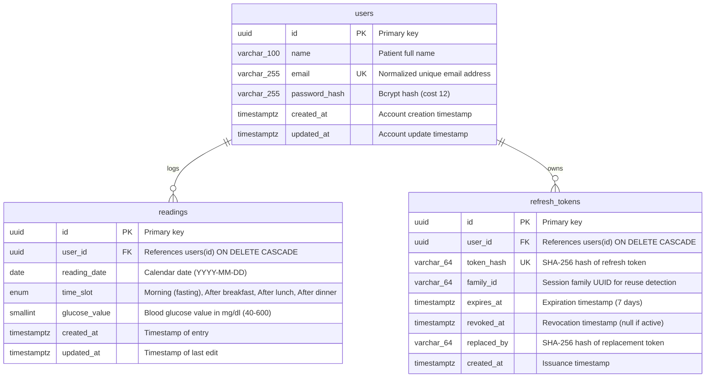
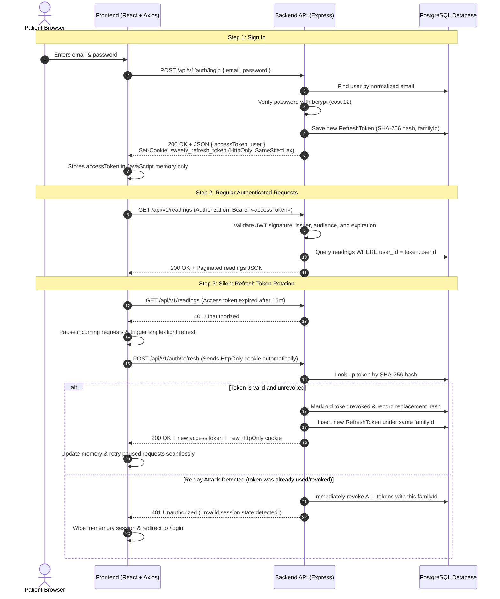

# Sweety – Blood Glucose Tracker

Sweety is a personal blood glucose tracking web app built to help people with diabetes log their daily readings, monitor glycemic patterns over time, and generate clear daily and monthly reports for themselves and their doctors.

It is built as a modular TypeScript monolith using **Node.js, Express, Prisma, and PostgreSQL** on the backend, and **React, TypeScript, Vite, Tailwind CSS, and TanStack Query** on the frontend. The entire stack runs locally with a single `docker compose up` command and comes with a full automated test suite.

---

## 📺 Video Walkthrough & Demo

Watch the end-to-end product demo and live walkthrough:

[](https://www.loom.com/share/d134d51a11994164a15becc061fb302a)

👉 **[Watch the Sweety Demo Video on Loom](https://www.loom.com/share/d134d51a11994164a15becc061fb302a)**

---

## Table of Contents

- [Video Walkthrough & Demo](#-video-walkthrough--demo)
- [What Sweety Does](#what-sweety-does)
- [System Architecture](#system-architecture)
- [Tech Stack](#tech-stack)
- [Project Structure](#project-structure)
- [Database Design](#database-design)
- [Authentication & Security](#authentication--security)
- [Quick Start Guide](#quick-start-guide)
- [Running with Docker](#running-with-docker)
- [Database Migrations & Sample Data](#database-migrations--sample-data)
- [Testing](#testing)
- [API Reference](#api-reference)
- [Validation Rules](#validation-rules)
- [Environment Variables](#environment-variables)
- [CI/CD Pipeline](#cicd-pipeline)
- [Engineering Decisions & Future Roadmap](#engineering-decisions--future-roadmap)

---

## What Sweety Does

- **4 Structured Daily Slots**: Patients can log blood sugar readings across four clinical slots: `Morning (fasting)`, `After breakfast`, `After lunch`, and `After dinner`.
- **Sensible Clinical Validations**: Rejects values below 40 or above 600 mg/dl, blocks future dates, enforces a maximum of 4 readings per day, and prevents duplicate entries for the same slot.
- **Instant Aggregations & Reports**: Calculates exact highest, lowest, and average glucose levels (rounded to one decimal place) across three scopes:
  - **Daily**: All readings for a selected calendar date.
  - **Month-to-Date (MTD)**: From the 1st of the month through the selected date.
  - **Whole Previous Month**: The entire preceding calendar month (correctly handling leap years and December-to-January year boundaries).
- **Interactive Patient Dashboard**:
  - Date selector with previous/next day navigation.
  - Daily slot timeline showing recorded readings, clinical status badges (Normal, Elevated, High, Low), and quick add/edit actions.
  - 30-day glycemic trend chart powered by Recharts with clinical target reference bands.
  - Full paginated logbook showing 20 readings per page with previous/next controls.
- **Secure by Default**:
  - 15-minute access tokens stored purely in JavaScript memory (never touching `localStorage` to eliminate XSS token theft).
  - 7-day refresh tokens stored as SHA-256 hashes in PostgreSQL and sent via HTTP-only, `SameSite=Lax` cookies.
  - Automatic refresh token rotation with session family tracking: replaying a revoked token immediately invalidates the entire session family.
- **Interactive Swagger Documentation**: Built-in OpenAPI 3.0 documentation available directly at `/api/docs`.

---

## System Architecture



---

## Tech Stack

| Layer | Technology | Why We Chose It |
|---|---|---|
| **Frontend** | React 18 & TypeScript | Component-driven UI with end-to-end type safety |
| | Vite 6 | Sub-second dev server startup and fast production builds |
| | Tailwind CSS 3.4 | Clean, accessible clinical styling with subtle lavender accents |
| | TanStack Query 5 | Automatic caching, background refetching, and query invalidation |
| | React Hook Form & Zod | Fast client-side form validation mirroring backend schemas |
| | Recharts 2.15 | Responsive SVG charts for visualizing 30-day glycemic trends |
| **Backend** | Node.js 22 LTS & Express 4 | Lightweight, high-throughput asynchronous HTTP runtime |
| | TypeScript 5.7 | Strict type-checking across controllers, services, and repositories |
| | Prisma ORM 7.10 | Type-safe database queries, schema migrations, and clean relationship modeling |
| | PostgreSQL 16 | ACID-compliant relational storage, native date types, and composite constraints |
| | Pino Logger | Fast JSON logging with automatic PII and credential redaction |
| **Security** | JWT & Bcrypt | Stateless in-memory access tokens, bcrypt password hashing (cost 12) |
| | Cookie Security | HTTP-only, SameSite=Lax, path-scoped cookies with SHA-256 token hashing |
| | Defense in Depth | Helmet security headers, CORS origin whitelisting, and Express rate limiting |
| **DevOps** | Docker & Docker Compose | Consistent multi-container environments across dev, CI, and production |
| | Nginx Alpine | High-performance reverse proxy, SPA fallback routing, and gzip compression |
| | GitHub Actions | Automated CI pipeline running typecheck, builds, and 111 integration tests |

---

## Project Structure

Sweety is organized as an npm workspace monorepo separating client and server code cleanly:

```
sweety/
├── .github/
│   └── workflows/
│       └── ci.yml               # Automated CI workflow (Build, Typecheck, Tests)
├── client/                      # Frontend Single Page Application
│   ├── src/
│   │   ├── api/                 # Axios client, token store, and refresh queue
│   │   ├── components/          # Dashboard, daily timeline, chart, logbook, modals
│   │   ├── config/              # Validated environment configuration
│   │   ├── context/             # AuthContext (user session and silent refresh)
│   │   ├── pages/               # Dashboard, Login, Register, Reports, Profile
│   │   ├── types/               # TypeScript interfaces and clinical enums
│   │   ├── utils/               # Glycemic status helpers (Normal, High, Low)
│   │   ├── App.tsx              # Router setup with ProtectedRoute guards
│   │   └── main.tsx             # React entrypoint
│   ├── Dockerfile               # Multi-stage build (Vite builder + Nginx runner)
│   ├── nginx.conf               # Production Nginx reverse-proxy configuration
│   └── package.json             # Frontend dependencies and scripts
├── server/                      # Backend REST API
│   ├── prisma/
│   │   ├── migrations/          # Version-controlled SQL migration history
│   │   ├── schema.prisma        # Database schema, indexes, and constraints
│   │   └── seed.ts              # Idempotent deterministic database seeder
│   ├── src/
│   │   ├── config/              # PostgreSQL pool, environment config, Pino logger
│   │   ├── docs/                # OpenAPI 3.0 specification (openapi.json)
│   │   ├── errors/              # Centralized AppError hierarchy and errorHandler
│   │   ├── middlewares/         # JWT verification, Zod validation, rate limiter
│   │   ├── modules/
│   │   │   ├── auth/            # Authentication (Controller, Service, Repository)
│   │   │   ├── readings/        # Readings CRUD, pagination, and business rules
│   │   │   └── reports/         # Daily, MTD, and Monthly aggregations
│   │   ├── types/               # Express request augmentations and API contracts
│   │   ├── app.ts               # Express app factory with middleware stack
│   │   └── index.ts             # Server entrypoint with graceful shutdown
│   ├── docker-entrypoint.sh     # Automatic migration runner for containers
│   ├── Dockerfile               # Production multi-stage build (non-root node user)
│   └── package.json             # Backend dependencies and scripts
├── docker-compose.yml           # Multi-container orchestration (DB, Server, Client)
├── package.json                 # Monorepo root workspace configuration
└── README.md                    # Project documentation
```

---

## Database Design



### Key Database Constraints & Performance Indexes
- **`user_date_slot_unique`**: `UNIQUE(user_id, reading_date, time_slot)` guarantees that a patient can never have more than one reading for the same slot on the same date.
- **`glucose_value_range_check`**: PostgreSQL `CHECK (glucose_value >= 40 AND glucose_value <= 600)` prevents corrupt numbers from entering the database.
- **Composite Index**: `INDEX (user_id, reading_date DESC)` ensures pagination, daily timeline lookups, and monthly aggregations run with indexed index scans.
- **Token Index**: Indexed on `(user_id)` and `(family_id)` so token rotation and session revocation complete in single-digit milliseconds.

---

## Authentication & Security

Sweety avoids storing sensitive tokens in `localStorage` or `sessionStorage` where any third-party script or XSS vulnerability could read them:



---

## Quick Start Guide

### Prerequisites
- **Node.js**: v20 or v22 (LTS)
- **npm**: v10 or higher
- **PostgreSQL**: Local Postgres 16 instance or Docker

### 1. Clone & Install
```bash
git clone <repository-url>
cd Blood-Glucose-Tracker
npm install
```

### 2. Environment Files
```bash
cp .env.example .env
cp server/.env.example server/.env
cp client/.env.example client/.env
```

### 3. Start Database & Seed Sample Data
If you have Docker installed, start Postgres with one command:
```bash
docker compose up -d postgres
```

Then run the database setup:
```bash
# Generate Prisma Client
npm run prisma:generate

# Run migrations
npm run prisma:migrate

# Seed sample patient and 60 days of realistic readings
npm run seed
```

> **Demo Login Credentials** (seeded automatically):
> - **Email**: `patient@sweety.app`
> - **Password**: `Password123!`

### 4. Start Development Servers
```bash
# Terminal 1: Backend API (port 5000 with hot-reload)
npm run dev:server

# Terminal 2: Frontend Client (port 5173 with Vite HMR)
npm run dev:client
```

Open your browser and navigate to **[http://localhost:5173](http://localhost:5173)**.

---

## Running with Docker

You can run the full production-ready stack (PostgreSQL + Express Backend + Nginx Frontend) without installing Node or Postgres on your host machine:

```bash
# Build images and start all containers in the background
docker compose up -d --build

# View real-time logs across all services
docker compose logs -f

# Check running container status and health checks
docker compose ps

# Stop containers (database data is preserved in a Docker volume)
docker compose down

# Stop containers and wipe the database volume
docker compose down -v
```

Once started:
- **Web App**: [http://localhost:5173](http://localhost:5173)
- **API Health Check**: [http://localhost:5000/health](http://localhost:5000/health)
- **Swagger Documentation**: [http://localhost:5000/api/docs](http://localhost:5000/api/docs)

---

## Database Migrations & Sample Data

### Working with Prisma
```bash
# Generate the Prisma client after schema changes
npm run prisma:generate

# Apply migrations to your local or staging database
npm run prisma:migrate

# Open Prisma Studio to browse tables in a web UI
npm run prisma:studio
```

### Idempotent Seeder
The seed script (`server/prisma/seed.ts`) is safe to run multiple times:
- Upserts the demo patient (`patient@sweety.app`) with bcrypt cost 12.
- Generates **240 clinical readings across 60 days** spanning both the current and previous calendar months.
- Populates all 4 clinical slots daily with realistic physiological values (85–175 mg/dl).
- Automatically avoids duplicate slot collisions.

```bash
npm run seed
```

---

## Testing

The project has automated integration, validation, security, and UI tests.

```bash
# Run all tests across backend and frontend (111 tests total)
npm test

# Run backend tests only
npm test --workspace=server

# Run frontend component and integration tests only
npm test --workspace=client

# Run static TypeScript typechecking across all workspaces
npm run typecheck

# Test production build bundling
npm run build
```

### Test Coverage Highlights
- **Authentication**: Registration, bcrypt hashing verification, JWT token expiration, atomic token rotation, token replay family revocation, and logout.
- **Readings CRUD & Concurrency**: 40–600 mg/dl boundary checks, 4-reading daily cap, cross-user IDOR isolation, and catching concurrent duplicate slot submissions.
- **Reports & Date Math**: Leap year handling (Feb 29), December-to-January year boundaries, and verifying that averages aggregate actual readings rather than averaging daily averages.
- **Security Audit**: Bcrypt 72-character limits, JWT algorithm confusion defense, 15kb HTTP request size caps, and rate-limiting enforcement.
- **Frontend**: Form validation, in-memory token safety, silent refresh queueing, and session restoration.

---

## API Reference

Interactive Swagger documentation is available at **`/api/docs`**.

### Auth Endpoints (`/api/v1/auth`)

| Method | Endpoint | Auth Required | Description | Status Codes |
|---|---|---|---|---|
| `POST` | `/api/v1/auth/register` | None | Register a new patient account | `201`, `400`, `409` |
| `POST` | `/api/v1/auth/login` | None | Log in; issues access token + sets HTTP-only refresh cookie | `200`, `400`, `401` |
| `POST` | `/api/v1/auth/refresh` | Cookie | Rotates refresh token and issues a new access token | `200`, `401` |
| `POST` | `/api/v1/auth/logout` | Cookie | Revokes active refresh token and clears cookie | `200` |
| `POST` | `/api/v1/auth/logout-all`| Bearer | Revokes all active refresh tokens across all devices | `200`, `401` |
| `GET` | `/api/v1/auth/me` | Bearer | Returns the logged-in patient's profile | `200`, `401` |

### Readings Endpoints (`/api/v1/readings`)

All readings endpoints are scoped to the authenticated patient. Attempting to access another user's reading returns `404 Not Found`.

| Method | Endpoint | Auth Required | Description | Status Codes |
|---|---|---|---|---|
| `POST` | `/api/v1/readings` | Bearer | Record a new glucose reading (max 4/day, 1 per slot) | `201`, `400`, `401`, `409` |
| `GET` | `/api/v1/readings?page=1&limit=20` | Bearer | Paginated readings list with total count and metadata | `200`, `400`, `401` |
| `GET` | `/api/v1/readings/:id` | Bearer | Fetch a single reading by its ID | `200`, `401`, `404` |
| `PATCH` | `/api/v1/readings/:id` | Bearer | Update a reading's value, slot, or date | `200`, `400`, `401`, `404`, `409` |
| `DELETE` | `/api/v1/readings/:id` | Bearer | Delete a reading | `200`, `401`, `404` |

#### Paginated Readings Response Example
```json
{
  "success": true,
  "data": {
    "readings": [
      {
        "id": "c1f729e2-36a8-4c91-9e2e-8367a7b83d10",
        "userId": "9e54b7f1-dfc1-45cd-90b6-50265319c27f",
        "readingDate": "2026-11-07",
        "timeSlot": "After lunch",
        "glucoseValue": 128,
        "value": 128,
        "createdAt": "2026-11-07T13:45:00.000Z",
        "updatedAt": "2026-11-07T13:45:00.000Z"
      }
    ],
    "pagination": {
      "total": 38,
      "page": 1,
      "limit": 20,
      "totalPages": 2,
      "hasNextPage": true,
      "hasPreviousPage": false
    }
  },
  "meta": {
    "total": 38,
    "page": 1,
    "limit": 20,
    "totalPages": 2,
    "hasNextPage": true,
    "hasPreviousPage": false
  }
}
```

### Reports Endpoints (`/api/v1/reports`)

| Method | Endpoint | Auth Required | Description | Status Codes |
|---|---|---|---|---|
| `GET` | `/api/v1/reports/daily?date=YYYY-MM-DD` | Bearer | Daily stats + full list of readings for that calendar date | `200`, `400`, `401` |
| `GET` | `/api/v1/reports/month-to-date?date=YYYY-MM-DD`| Bearer | Aggregated metrics from the 1st of the month to date | `200`, `400`, `401` |
| `GET` | `/api/v1/reports/monthly?date=YYYY-MM-DD` | Bearer | Aggregated metrics across the entire preceding month | `200`, `400`, `401` |

#### Daily Report Response Example
```json
{
  "success": true,
  "data": {
    "report": {
      "reportType": "daily",
      "selectedDate": "2026-11-07",
      "dateRange": {
        "startDate": "2026-11-07",
        "endDate": "2026-11-07"
      },
      "stats": {
        "highest": 145,
        "lowest": 88,
        "average": 122.5,
        "count": 4,
        "totalReadings": 4
      },
      "readings": [
        {
          "id": "c1f729e2-36a8-4c91-9e2e-8367a7b83d10",
          "readingDate": "2026-11-07",
          "timeSlot": "Morning (fasting)",
          "glucoseValue": 88,
          "createdAt": "2026-11-07T07:15:00.000Z"
        }
      ],
      "isEmpty": false
    }
  }
}
```

---

## Validation Rules

| Rule # | Requirement | Invalid Condition | Error Message |
|---|---|---|---|
| **1** | **Glucose Value Required** | Omitted, `null`, or empty string | `"Please enter a glucose value."` |
| **2** | **Clinical Range Boundary** | Non-integer, `< 40`, or `> 600` | `"Value must be between 40 and 600 mg/dl."` |
| **3** | **One Reading Per Slot Per Day** | Duplicate slot on the same date | `"You already have an [Slot Name] reading for this date."` |
| **4** | **Maximum 4 Readings Per Day** | Attempting to add a 5th reading on a date | `"You can add only 4 readings per day."` |
| **5** | **No Future Dates** | `readingDate > current calendar date` | `"Date cannot be in the future."` |

---

## Environment Variables

| Variable | Target | Default | Description |
|---|---|---|---|
| `NODE_ENV` | Server | `development` | Application mode (`development`, `production`, `test`) |
| `PORT` | Server | `5000` | Port for the Express API |
| `CLIENT_URL` | Server | `http://localhost:5173` | Allowed frontend origin for CORS and CSRF checks |
| `DATABASE_URL` | Server | `postgresql://...` | PostgreSQL connection string |
| `JWT_ACCESS_SECRET` | Server | *(Min 32 characters)* | Secret used to sign and verify access tokens |
| `JWT_ACCESS_EXPIRES_IN`| Server | `15m` | Lifetime of in-memory access tokens |
| `JWT_ISSUER` | Server | `sweety-api` | JWT issuer claim |
| `JWT_AUDIENCE` | Server | `sweety-client` | JWT audience claim |
| `REFRESH_TOKEN_EXPIRES_DAYS`| Server | `7` | Duration before refresh token expires |
| `REFRESH_COOKIE_NAME` | Server | `sweety_refresh_token` | HTTP-only cookie name |
| `SEED_ON_STARTUP` | Docker | `true` | Automatically run seed script on container start |
| `VITE_API_BASE_URL` | Client | `/api/v1` | Relative API base URL routed via Nginx / Vite proxy |

---

## CI/CD Pipeline

The GitHub Actions workflow (`.github/workflows/ci.yml`) runs on every push and pull request to `main`:

1. **PostgreSQL Service Container**: Spins up a real PostgreSQL 16 container on Ubuntu with health monitoring.
2. **Deterministic Setup**: Runs `npm ci` with dependency caching for repeatable builds.
3. **Database Migrations**: Applies `prisma migrate deploy` to the test database.
4. **TypeScript Typecheck**: Executes `tsc --noEmit` across both server and client workspaces.
5. **Production Build**: Runs `npm run build` validating both server compilation and Vite bundling.
6. **Automated Test Run**: Executes the complete test suite (89 server tests and 17 client tests).

---

## Engineering Decisions & Future Roadmap

### Core Engineering Decisions Made in Sweety

1. **In-Memory JWT Access Tokens + HTTP-Only Refresh Cookies**:
   - Storing access tokens in `localStorage` or `sessionStorage` exposes users to token exfiltration via XSS attacks.
   - We store the short-lived (15 min) access token purely in JavaScript memory within a React closure.
   - The long-lived (7 day) refresh token is stored in an HTTP-only, `SameSite=Lax` cookie and persisted as a SHA-256 hash in PostgreSQL.
   - Every refresh request rotates the token. If an already-rotated token is ever presented again (a sign of token theft or replay), the system immediately revokes all tokens belonging to that session family.

2. **Calendar Dates vs. Naive UTC Timestamps**:
   - Medical logs belong to specific calendar days (e.g., "Nov 7, 2026").
   - If dates are stored as continuous timestamps, a reading logged late in the evening in San Francisco (UTC-8) or early morning in Tokyo (UTC+9) can shift into the wrong calendar date when serialized into UTC.
   - We store reading dates as strict PostgreSQL `DATE` types (`YYYY-MM-DD`) and parse dates strictly by year, month, and day components.

3. **Concurrency Defense & The Double-Click Problem**:
   - When users double-click "Submit" or submit from multiple devices at once, checking for an existing reading in application code leaves a Time-of-Check to Time-of-Use (TOCTOU) race condition.
   - We use a dual-layer defense: a friendly service-level pre-check, backed by a database composite unique constraint `(user_id, reading_date, time_slot)`. If a collision occurs at the exact millisecond, PostgreSQL rejects the second insert and the API returns a structured `409 Conflict`.

4. **Offset Pagination vs. Cursor Pagination**:
   - We implemented offset pagination (`page`, `limit`, `skip = (page - 1) * limit`) with parallel `Promise.all([findMany, count])` and deterministic 3-tuple sorting (`readingDate DESC`, `createdAt DESC`, `id DESC`).
   - This was chosen to satisfy the requirements for jump-to-page navigation and total record counts.
   - *Scalability Trade-Off*: At massive scale (millions of readings), PostgreSQL `OFFSET N` scans and discards $N$ rows, and concurrent inserts cause page drift. In high-frequency time-series systems, migrating to cursor/keyset pagination (`WHERE (reading_date, created_at, id) < (cursor)`) achieves $O(1)$ index seek performance.

---

### Future Roadmap & Architectural Enhancements

#### 1. Redis & BullMQ Asynchronous Task Queue
To keep the Node.js event loop fast and responsive under heavy load, background tasks will be moved off the main HTTP request thread to a dedicated **Redis + BullMQ** job queue:
- **Automated Evening Reminders**: A scheduled recurring cron job running at 8:00 PM checks for patients who have not yet logged their "After dinner" reading and queues personalized push notifications and email reminders.
- **Heavy Monthly Clinical PDF Exports**: Generating detailed, multi-page PDF health summaries with embedded Recharts SVG graphs will be processed asynchronously by worker processes and stored in Amazon S3 / Google Cloud Storage, notifying the patient when their download is ready.
- **Hypoglycemia & Hyperglycemia Emergency Alerts**: Whenever a reading is recorded below 70 mg/dl (severe hypoglycemia) or above 250 mg/dl (severe hyperglycemia), an async worker immediately dispatches SMS and email alerts to the patient's emergency contacts or attending physician.
- **High-Performance Analytics Caching**: Frequently accessed monthly aggregations and patient profile data will be cached in Redis with automated cache invalidation on any reading creation, update, or deletion.

#### 2. Doctor Role & Clinical Provider Portal (RBAC)
Diabetes care is collaborative between patients and endocrinologists. We plan to expand Sweety's single-role model into a multi-tenant **Role-Based Access Control (RBAC)** system:
- **User Roles**: Support `PATIENT`, `DOCTOR`, and `CLINICIAN_ADMIN`.
- **Consent-Based Doctor-Patient Mapping**: Patients can share access with their doctor via a secure invite code or email request. A `DoctorPatientMapping` relationship tracks access states (`PENDING`, `ACTIVE`, `REVOKED`).
- **Clinician Dashboard**:
  - Doctors can view linked patients, inspect their daily timelines, and review 30-day glycemic trends.
  - Ability to add clinical notes and recommendations directly on specific readings.
  - Set custom target glycemic bands (e.g., target 80–140 mg/dl for Type 1 vs. 90–160 mg/dl for Type 2) per patient.
- **Audit Trails**: Detailed access logging recording every time a clinician views or exports patient records to maintain HIPAA and GDPR compliance.

#### 3. Email Verification & Secure Account Recovery
- **Async Email Verification on Signup**: Upon registration, an unverified patient receives an email containing a cryptographically signed verification link with a 24-hour expiration, dispatched via a BullMQ worker queue using Resend or SendGrid.
- **Password Reset Workflows**: Secure, single-use reset tokens with strict 15-minute expirations and rate-limiting to prevent account enumeration and credential stuffing.
- **Magic Link Authentication**: Optional passwordless sign-in via one-time email links for improved accessibility for elderly patients.

#### 4. Hardware & Device Integrations
- **Web Bluetooth API Sync**: Direct browser pairing with commercial Bluetooth Low Energy (BLE) glucometers (e.g., Accu-Chek Guide, Contour Next One) to automatically import readings without manual data entry.
- **Continuous Glucose Monitor (CGM) Streams**: Ingestion pipelines for streaming sensor data from platforms like Dexcom and Abbott FreeStyle Libre APIs.
