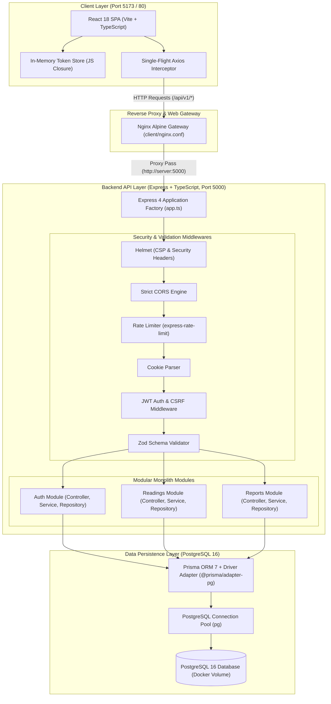
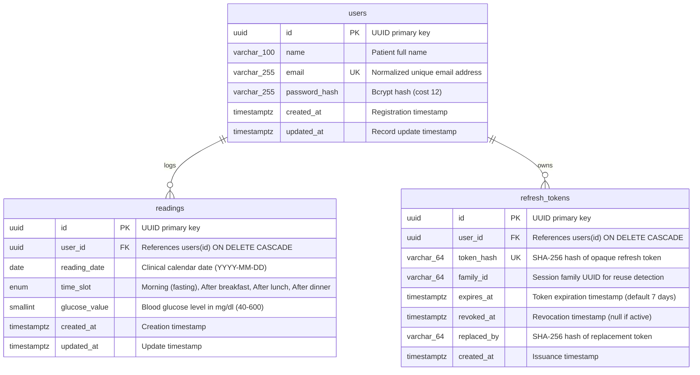
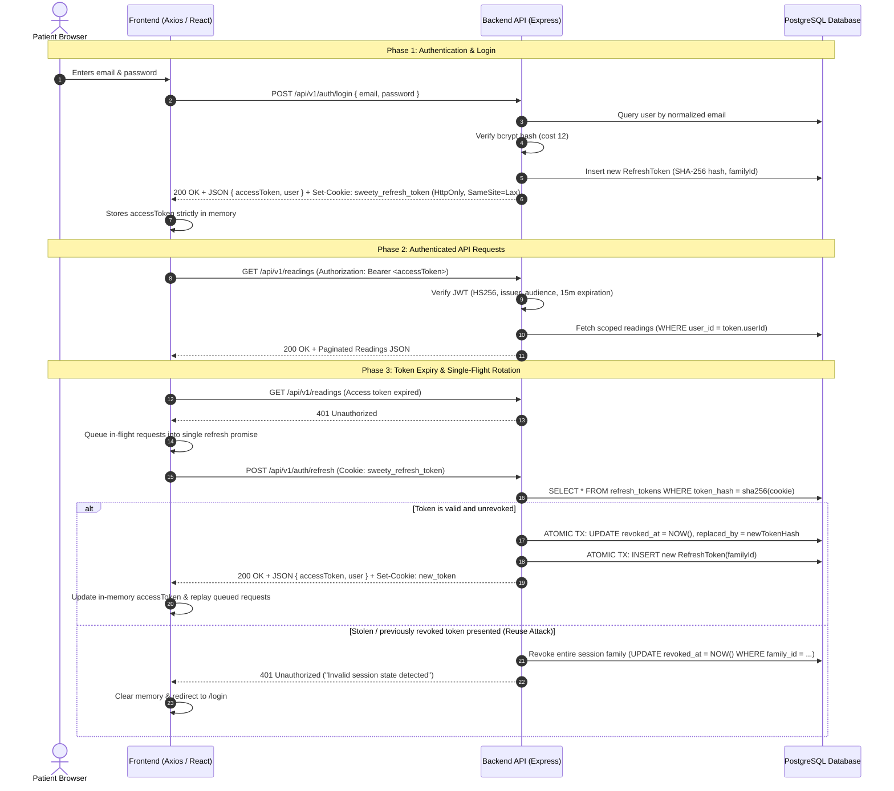

# Sweety – Blood Glucose Tracker

A production-grade, clinical personal blood glucose tracking web application designed for diabetes patients to log up to 4 readings per day, analyze daily and monthly aggregated metrics, and monitor glycemic patterns over time.

---

## 📋 Table of Contents

- [Overview & Key Features](#-overview--key-features)
- [System Architecture](#-system-architecture)
- [Technology Stack](#-technology-stack)
- [Monorepo Directory Structure](#-monorepo-directory-structure)
- [Database Schema & ER Diagram](#-database-schema--er-diagram)
- [Authentication & Token Rotation Flow](#-authentication--token-rotation-flow)
- [Local Development Setup](#-local-development-setup)
- [Docker & Containerized Deployment](#-docker--containerized-deployment)
- [Database Migrations & Seed Data](#-database-migrations--seed-data)
- [Automated Testing Suite](#-automated-testing-suite)
- [API Reference & Documentation](#-api-reference--documentation)
- [Business Validation Rules Matrix](#-business-validation-rules-matrix)
- [Environment Variables Reference](#-environment-variables-reference)
- [CI/CD Pipeline](#-cicd-pipeline)
- [Engineering Decisions & Future Roadmap](#-engineering-decisions--future-roadmap)

---

## 🌟 Overview & Key Features

Sweety is engineered as a secure, modular monolith designed for patient autonomy and clinical reliability:

- **Clinical Reading Logging**: Record blood glucose levels across 4 defined daily slots: `Morning (fasting)`, `After breakfast`, `After lunch`, and `After dinner`.
- **Enforced Business Validation**: Strict adherence to Kenpath clinical requirements: valid integer range (40–600 mg/dl), no future dates, maximum 4 readings per day, and unique reading per user/date/slot.
- **Multi-Tenant Isolation**: Row-level tenant boundary scoping ensures patients can only query, modify, or delete their own health data. Cross-user access returns `404 Not Found` to prevent identity enumeration.
- **Dual-Layer Concurrency Defense**: Database composite unique constraint `(user_id, reading_date, time_slot)` acts as the final defense against simultaneous duplicate submissions, returning structured `409 Conflict`.
- **Glycemic Aggregations & Reports**: Daily, Month-to-Date (MTD), and Whole Previous Month metrics calculating exact highest, lowest, and average glucose levels (rounded to 1 decimal place) alongside reading counts.
- **Enterprise-Grade Authentication**:
  - Stateless 15-minute JWT access tokens held strictly in JavaScript memory (zero `localStorage` / `sessionStorage` XSS exposure).
  - Cryptographically random opaque refresh tokens stored exclusively as SHA-256 hashes in PostgreSQL.
  - Automatic single-flight refresh token rotation with session family tracking and reuse revocation.
  - HTTP-only, SameSite=Lax cookies with path-scoped routing and CSRF origin validation.
- **Interactive Swagger Documentation**: Built-in interactive OpenAPI 3.0.3 UI at `/api/docs`.

---

## 🏗️ System Architecture



---

## 💻 Technology Stack

| Layer | Component | Technologies & Packages |
|---|---|---|
| **Frontend** | Framework & Build | React 18, TypeScript 5.7, Vite 6, Tailwind CSS 3.4 |
| | Routing & State | React Router 6, TanStack Query 5 (Server State) |
| | Forms & Validation | React Hook Form 7, Zod 3.24, `@hookform/resolvers` |
| | UI & Visualization | Lucide React, Recharts 2.15, Native Tailwind Palette |
| **Backend** | Runtime & Framework | Node.js 22 LTS, Express 4.21, TypeScript 5.7 |
| | Architecture Pattern | Modular Monolith (Routes &rarr; Middlewares &rarr; Controllers &rarr; Services &rarr; Repositories) |
| | Database Access | Prisma ORM 7.10, `@prisma/adapter-pg`, `pg` 8.13 Connection Pool |
| | Logging & Telemetry | Pino 10 (`pino-http`) with automated PII & credential redaction |
| **Security** | Authentication | `jsonwebtoken` (HS256 pinned), `bcryptjs` (cost 12), `crypto` (SHA-256) |
| | Network & Defense | `helmet` 8, `cors`, `express-rate-limit` 8, CSRF Origin Verifier |
| **DevOps & CI** | Containers & Orchestration | Docker, Multi-Stage Dockerfiles, Docker Compose, Alpine Linux |
| | CI/CD | GitHub Actions Workflow with PostgreSQL Service Container |
| | Web Server | Nginx Alpine (Reverse proxy, Gzip compression, SPA fallback) |

---

## 📂 Monorepo Directory Structure

```
sweety/
├── .github/
│   └── workflows/
│       └── ci.yml               # GitHub Actions CI workflow (Build, Typecheck, Tests)
├── client/                      # Frontend Single Page Application
│   ├── src/
│   │   ├── api/                 # Axios client, token storage & single-flight interceptor
│   │   ├── components/          # Layout, Navigation, Reading modals, History, Reports
│   │   ├── config/              # Zod environment variable parsing
│   │   ├── context/             # AuthContext provider & hooks
│   │   ├── pages/               # Register, Login, Dashboard, Add/Edit Reading, Reports, Profile
│   │   ├── types/               # Domain interfaces & clinical enums
│   │   ├── App.tsx              # Application routes & RootRedirect guard
│   │   └── main.tsx             # React DOM entrypoint with React.StrictMode
│   ├── Dockerfile               # Production multi-stage build (Node builder + Nginx runner)
│   ├── nginx.conf               # Production Nginx reverse-proxy configuration
│   ├── package.json             # Frontend dependencies & scripts
│   ├── tailwind.config.js       # Lavender & glucose status badge themes
│   └── vite.config.ts           # Vite dev server with /api reverse proxy
├── server/                      # Backend REST API
│   ├── prisma/
│   │   ├── migrations/          # Version-controlled SQL migration history
│   │   ├── schema.prisma        # Database schema, indexes & constraints
│   │   └── seed.ts              # Idempotent deterministic database seeder
│   ├── src/
│   │   ├── config/              # PostgreSQL pool, environment config, Pino logger
│   │   ├── docs/                # OpenAPI 3.0.3 specification (openapi.json)
│   │   ├── errors/              # Centralized AppError hierarchy & errorHandler
│   │   ├── middlewares/         # JWT verification, Zod validation, Rate limiter, CSRF
│   │   ├── modules/
│   │   │   ├── auth/            # Authentication (Routes, Controller, Service, Repository, Validator)
│   │   │   ├── readings/        # Clinical Readings (Routes, Controller, Service, Repository, Validator)
│   │   │   └── reports/         # Glycemic Reports (Routes, Controller, Service, Repository, Validator)
│   │   ├── types/               # Express request augmentations & API contracts
│   │   ├── app.ts               # Express application factory with middleware stack
│   │   └── index.ts             # Server entrypoint with graceful shutdown handlers
│   ├── docker-entrypoint.sh     # Container migration runner & entrypoint script
│   ├── Dockerfile               # Production multi-stage build with non-root node user
│   ├── package.json             # Backend dependencies & scripts
│   └── tsconfig.json            # Server TypeScript configuration
├── docker-compose.yml           # Production-ready multi-container orchestration
├── package.json                 # Monorepo root workspace configuration
├── tsconfig.base.json           # Shared strict TypeScript base configuration
├── SECURITY_AUDIT.md            # Comprehensive application security & QA audit report
├── .env.example                 # Global environment variables template
└── README.md                    # Project documentation
```

---

## 🗄️ Database Schema & ER Diagram



### Database Constraints & Indexes
- **`user_date_slot_unique`**: `UNIQUE(user_id, reading_date, time_slot)` enforces exactly one reading per slot per day at the database layer.
- **`glucose_value_range_check`**: PostgreSQL `CHECK (glucose_value >= 40 AND glucose_value <= 600)` prevents out-of-range clinical entries.
- **Compound Performance Index**: `CREATE INDEX ON readings (user_id, reading_date DESC)` enables instant pagination and calendar range lookups.
- **Token Indexes**: Indexed on `user_id` and `family_id` to ensure sub-millisecond atomic session family revocation.

---

## 🔐 Authentication & Token Rotation Flow

Sweety implements the OAuth 2.0 Refresh Token Rotation pattern with session family reuse detection:



---

## 🚀 Local Development Setup

### Prerequisites
- **Node.js**: `v20.x` or `v22.x` (LTS)
- **npm**: `v10.x` or higher
- **PostgreSQL**: `16.x` (via local service or Docker container)

### Step-by-Step Installation

1. **Clone the Repository**:
   ```bash
   git clone <repository-url>
   cd sweety
   ```

2. **Install Monorepo Dependencies**:
   ```bash
   npm install
   ```

3. **Configure Environment Variables**:
   ```bash
   cp .env.example .env
   cp server/.env.example server/.env
   cp client/.env.example client/.env
   ```

4. **Start PostgreSQL with Docker (or connect to your local Postgres)**:
   ```bash
   docker compose up -d postgres
   ```

5. **Run Prisma Migrations & Seed Sample Data**:
   ```bash
   # Generate Prisma 7 Client
   npm run prisma:generate

   # Apply versioned database migrations
   npm run prisma:migrate

   # Seed demo patient and 60 days of clinical readings
   npm run seed
   ```

   > **Local Evaluation Demo Credentials**:
   > - **Email**: `patient@sweety.app`
   > - **Password**: `Password123!`

6. **Launch Development Servers**:
   ```bash
   # Terminal 1: Backend API (port 5000 with hot-reload via tsx)
   npm run dev:server

   # Terminal 2: Frontend Client (port 5173 / 5174 via Vite)
   npm run dev:client
   ```

   Navigate to `http://localhost:5173` in your browser.

---

## 🐳 Docker & Containerized Deployment

Sweety includes a production-oriented, multi-container Docker Compose deployment featuring isolated networking, persistent volumes, container health checks, and automatic database migration execution.

### Architecture in Docker
- **`postgres`**: PostgreSQL 16 Alpine with persistent data volume `sweety_pgdata` and internal health check (`pg_isready`).
- **`server`**: Multi-stage Node 22 Alpine image running under non-root user `node`. Executes `prisma migrate deploy` on startup via `docker-entrypoint.sh` before serving API traffic.
- **`client`**: Multi-stage build compiling static Vite assets and serving them through Nginx Alpine with built-in SPA routing and `/api/` reverse proxying.

### Docker Commands

```bash
# Build and start all services in detached mode
docker compose up -d --build

# Inspect running container statuses and health checks
docker compose ps

# View unified live logs across all containers
docker compose logs -f

# View backend container logs specifically
docker compose logs -f server

# Run database seed manually inside the server container
docker compose exec server npm run seed

# Stop all containers (preserving database volume)
docker compose down

# Stop all containers and wipe persistent database storage
docker compose down -v
```

Once running:
- **Web Application**: [http://localhost:5173](http://localhost:5173)
- **Backend Health Check**: [http://localhost:5000/health](http://localhost:5000/health)
- **Interactive API Documentation**: [http://localhost:5000/api/docs](http://localhost:5000/api/docs)

---

## 🗃️ Database Migrations & Seed Data

### Prisma Migration Commands
```bash
# Generate Prisma Client
npm run prisma:generate

# Apply pending migrations to production/staging database
npm run prisma:migrate

# Launch interactive Prisma Studio GUI database browser
npm run prisma:studio
```

### Deterministic Seeder Details
The seed script (`server/prisma/seed.ts`) is **100% idempotent**:
- Upserts the demo patient (`patient@sweety.app`) with bcrypt cost 12.
- Generates **240 clinical readings across 60 consecutive days** covering both the current calendar month and previous calendar month.
- Populates all 4 clinical slots daily (`Morning (fasting)`, `After breakfast`, `After lunch`, `After dinner`) with realistic physiological glycemic values (85–175 mg/dl).
- Can be executed repeatedly without duplicate slot conflicts.

```bash
npm run seed
```

---

## 🧪 Automated Testing Suite

Sweety features a test suite with **100% passing tests** covering integration, validation, security, and UI components.

```bash
# Run the complete test suite across all monorepo workspaces
npm run test

# Run backend tests only (89 tests)
npm run test --workspace=server

# Run frontend tests only (16 tests)
npm run test --workspace=client

# Run static TypeScript typecheck across workspaces
npm run typecheck

# Execute production compilation build
npm run build
```

### Verified Test Categories
1. **Authentication Tests (`auth.test.ts`)**: Registration, password hashing verification, login, JWT signature/issuer/audience, token rotation, family reuse revocation, concurrent refresh handling, session logout.
2. **Readings CRUD & Validation Tests (`readings.integration.test.ts`, `readings.validator.test.ts`)**: All 5 Kenpath business rules, 4-slot daily limits, multi-tenant IDOR isolation, pagination boundaries, and database constraint defense against concurrent duplicate slot creation.
3. **Reports & Analytics Tests (`reports.integration.test.ts`)**: Daily calendar aggregation, Month-to-Date calculation, previous month duration, leap year handling (Feb 29), year-boundary rollbacks (Dec &rarr; Jan), and null empty states.
4. **Application Security Audit Tests (`security.test.ts`)**: Bcrypt 72-character maximum bound, JWT algorithm confusion defense, 15kb HTTP payload limit, and strict rate limiter enforcement.
5. **Frontend Client Tests (`App.test.tsx`, `client.test.ts`, `AuthPages.test.tsx`)**: Form validation, in-memory token safety, single-flight refresh concurrency queuing, and session restoration on browser refresh.

---

## 📖 API Reference & Documentation

Interactive Swagger documentation is available at **`/api/docs`** on the server.

### Authentication Endpoints (`/api/v1/auth`)

| Method | Endpoint | Auth | Description | Status Codes |
|---|---|---|---|---|
| `POST` | `/api/v1/auth/register` | None | Register new patient account with bcrypt cost 12 | `201`, `400`, `409` |
| `POST` | `/api/v1/auth/login` | None | Authenticate patient; issues access token + refresh cookie | `200`, `400`, `401` |
| `POST` | `/api/v1/auth/refresh` | Cookie | Atomic refresh token rotation with session family tracking | `200`, `401` |
| `POST` | `/api/v1/auth/logout` | Cookie | Revoke current session refresh token and clear cookie | `200` |
| `POST` | `/api/v1/auth/logout-all` | Bearer | Revoke all active session families across all devices | `200`, `401` |
| `GET` | `/api/v1/auth/me` | Bearer | Get authenticated patient identity and profile | `200`, `401` |

### Readings Management Endpoints (`/api/v1/readings`)

All reading operations are scoped by authenticated `user_id`. Attempting to access another patient's reading returns `404 Not Found`.

| Method | Endpoint | Auth | Description | Status Codes |
|---|---|---|---|---|
| `POST` | `/api/v1/readings` | Bearer | Log new glucose reading (max 4/day, 1 per slot/day) | `201`, `400`, `401`, `409` |
| `GET` | `/api/v1/readings?page=1&limit=20` | Bearer | Paginated reading list with total count and metadata | `200`, `400`, `401` |
| `GET` | `/api/v1/readings/:id` | Bearer | Retrieve individual reading by UUID | `200`, `401`, `404` |
| `PATCH` | `/api/v1/readings/:id` | Bearer | Update reading value, slot, or date | `200`, `400`, `401`, `404`, `409` |
| `DELETE` | `/api/v1/readings/:id` | Bearer | Remove clinical reading record | `200`, `401`, `404` |

### Glucose Reporting & Analytics Endpoints (`/api/v1/reports`)

| Method | Endpoint | Auth | Description | Status Codes |
|---|---|---|---|---|
| `GET` | `/api/v1/reports/daily?date=YYYY-MM-DD` | Bearer | Aggregated metrics for calendar date + full slot list | `200`, `400`, `401` |
| `GET` | `/api/v1/reports/month-to-date?date=YYYY-MM-DD` | Bearer | Metrics from 1st of month to selected date | `200`, `400`, `401` |
| `GET` | `/api/v1/reports/monthly?date=YYYY-MM-DD` | Bearer | Metrics across the entire previous calendar month | `200`, `400`, `401` |

#### Reading Creation Payload Example (`POST /api/v1/readings`)
```json
{
  "readingDate": "2026-11-07",
  "timeSlot": "After lunch",
  "glucoseValue": 128
}
```

#### Daily Report Response Example (`GET /api/v1/reports/daily?date=2026-11-07`)
```json
{
  "success": true,
  "data": {
    "report": {
      "reportType": "daily",
      "selectedDate": "2026-11-07",
      "dateRange": {
        "startDate": "2026-11-07",
        "endDate": "2026-11-07"
      },
      "stats": {
        "highest": 145,
        "lowest": 88,
        "average": 122.5,
        "count": 4,
        "totalReadings": 4
      },
      "readings": [
        {
          "id": "c1f729e2-36a8-4c91-9e2e-8367a7b83d10",
          "readingDate": "2026-11-07",
          "timeSlot": "Morning (fasting)",
          "glucoseValue": 88,
          "createdAt": "2026-11-07T07:15:00.000Z"
        }
      ],
      "isEmpty": false
    }
  }
}
```

---

## 🛡️ Business Validation Rules Matrix

| Rule # | Validation Requirement | Error Condition | Exact Error Message |
|---|---|---|---|
| **1** | **Glucose Value Required** | Omitted, `null`, or empty string | `"Please enter a glucose value."` |
| **2** | **Clinical Range Boundary** | Non-integer or `< 40` or `> 600` | `"Value must be between 40 and 600 mg/dl."` |
| **3** | **One Reading Per Slot Per Day** | Duplicate slot logged for identical date | `"You already have an [Slot Name] reading for this date."` |
| **4** | **Maximum 4 Readings Per Day** | Patient attempts to log 5th reading on date | `"You can add only 4 readings per day."` |
| **5** | **No Future Dates Allowed** | `readingDate > current calendar date` | `"Date cannot be in the future."` |

---

## ⚙️ Environment Variables Reference

| Variable | Scope | Default Value | Description |
|---|---|---|---|
| `NODE_ENV` | Server | `development` | Application mode (`development`, `production`, `test`) |
| `PORT` | Server | `5000` | HTTP listener port for Express API |
| `CLIENT_URL` | Server | `http://localhost:5173` | Allowed frontend origin for CORS & CSRF enforcement |
| `DATABASE_URL` | Server | `postgresql://...` | PostgreSQL connection string |
| `JWT_ACCESS_SECRET` | Server | *(Must be &ge; 32 chars)* | Secret key for signing and verifying JWT access tokens |
| `JWT_ACCESS_EXPIRES_IN`| Server | `15m` | Lifetime of in-memory access tokens |
| `JWT_ISSUER` | Server | `sweety-api` | Expected JWT issuer claim |
| `JWT_AUDIENCE` | Server | `sweety-client` | Expected JWT audience claim |
| `REFRESH_TOKEN_EXPIRES_DAYS`| Server| `7` | Duration before refresh token expires |
| `REFRESH_COOKIE_NAME` | Server | `sweety_refresh_token` | HTTP-only cookie name |
| `SEED_ON_STARTUP` | Docker | `true` | Automatically run seed script on container start |
| `VITE_API_BASE_URL` | Client | `/api/v1` | Relative API base URL routed via Nginx / Vite proxy |

---

## 🔄 CI/CD Pipeline

The GitHub Actions workflow (`.github/workflows/ci.yml`) executes on every `push` and `pull_request` to `main`:

1. **PostgreSQL Service Container**: Spins up PostgreSQL 16 on Ubuntu with health check monitoring.
2. **Deterministic Setup**: Installs locked dependencies via `npm ci` with caching.
3. **Database Migration Deployment**: Executes `prisma migrate deploy` against the active service container.
4. **Static Typechecking**: Runs `npm run typecheck` across both `server` and `client` workspaces.
5. **Production Compilation**: Executes `npm run build` validating both TypeScript compilation and Vite bundling.
6. **Integration & Security Testing**: Executes backend Vitest suite (89 tests) and frontend component suite (16 tests).

---

## 💡 Engineering Decisions & Future Roadmap

1. **Stateless Access Tokens vs. Stateful Refresh Tokens**:
   - Access tokens are short-lived (15 min) and stateless, reducing database load on high-frequency clinical queries.
   - Refresh tokens are stateful and tracked in PostgreSQL, enabling instant session revocation and session family tracking.
2. **Strict Calendar Date Representation**:
   - Dates are stored as PostgreSQL `DATE` types (`YYYY-MM-DD`). To prevent UTC/local date rollover bugs, dates are parsed and treated as calendar dates rather than arbitrary timestamps.
3. **Pino Redaction for HIPAA/Privacy Awareness**:
   - Credentials (`password`, `refreshToken`) and health figures (`glucoseValue`) are automatically masked in server log output.
4. **Future Roadmap**:
   - Clinical PDF export for endocrinologist consultations.
   - Provider portal with patient consent delegation.
   - Push notifications for missed evening readings.
   - Bluetooth Low Energy (BLE) integration with commercial glucometers.
